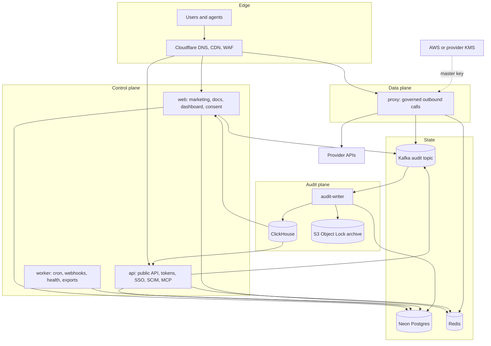
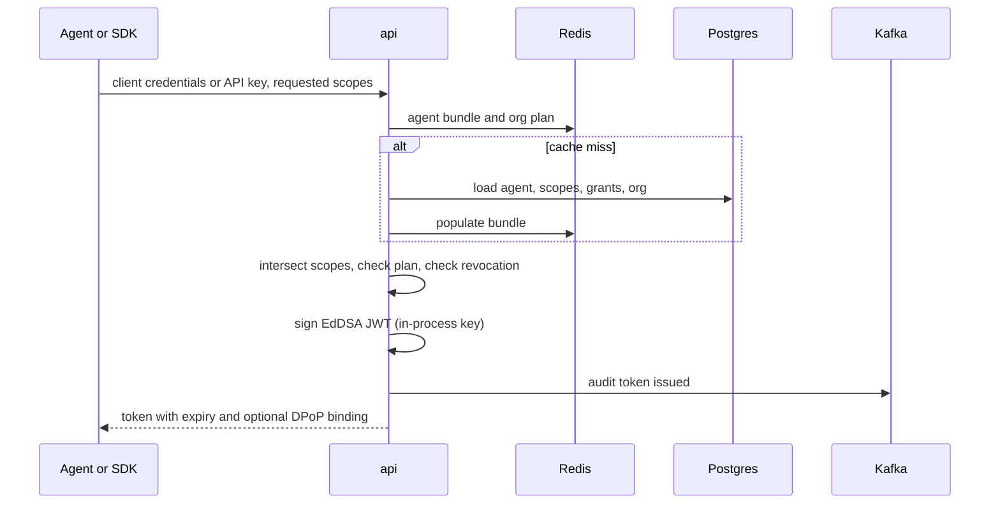
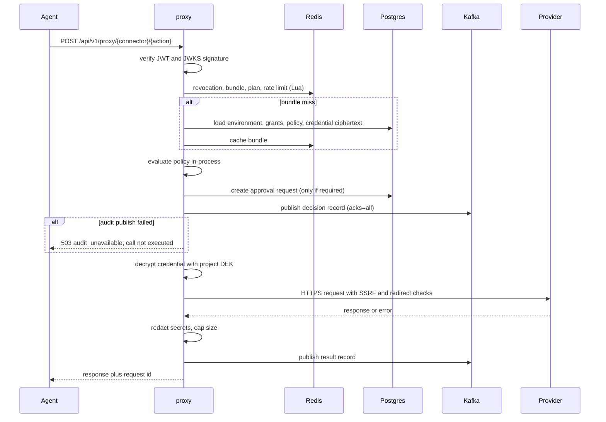
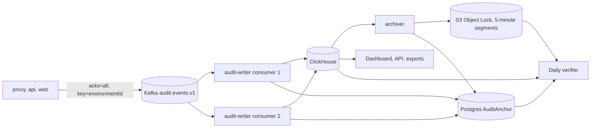

# System design — Authab at 10 million users

Status: draft v1, 17 November 2026. Implementation not started.
Audience: the founding engineers who will build and operate this.

This document describes the production architecture Authab needs to serve 10 million
end users, roughly 250,000 organizations and enterprise workloads, while staying
operable by a very small team. It is deliberately boring. Every hard problem is
delegated to a managed service, and the application keeps the smallest number of
moving parts that still meets the product's guarantees.

It is also honest about one thing up front: no system runs "without fail". What we
can engineer is **no single point of failure, a tested recovery path, fail-closed
behaviour where correctness matters, graceful degradation everywhere else, and a
number we can measure.** That is the actual promise, and it is stronger than a
slogan.

---

## 0. The whole system on one page

| Layer | Choice | Why |
| --- | --- | --- |
| Edge | Cloudflare (DNS, CDN, WAF, DDoS) | Managed, global, no servers to run |
| Web and dashboard | Next.js on a managed platform (container or serverless) | Already built; stateless; scales horizontally |
| Public API and token issuance | Same codebase, separate deployment | Different scaling and blast radius |
| Proxy data plane | Small Node service, same codebase | Hot path must scale and deploy independently |
| Background work | One worker process | Cron, webhooks, health probes, exports, retries |
| System of record | Neon Postgres, multi-AZ, one primary region | Transactions, constraints, familiar tooling |
| Hot counters and cache | Managed Redis, multi-AZ | Rate limits, usage, revocation, auth bundles |
| Audit transport | Managed Kafka, one topic, 12 partitions | Durable, ordered per environment, replayable |
| Audit queries | ClickHouse Cloud | Billions of rows, cheap scans, no impact on OLTP |
| Audit archive | AWS S3 with Object Lock (compliance mode) | Immutable legal record, 7-year retention |
| Billing | Stripe | Already integrated |
| Email | Resend | Already integrated |
| Observability | OpenTelemetry to a managed backend + error tracking | Already integrated; one place to look |

Four application services. All state in managed services. One region. No Kubernetes.
No self-hosted database, queue, or analytics store. One on-call rotation.

The rules that keep it simple:

1. **Postgres is the only system of record.** Everything else is a cache, a stream,
   or a copy.
2. **There is exactly one queue.** It carries audit events. Ordinary background jobs
   use `SELECT … FOR UPDATE SKIP LOCKED` in Postgres, because they are low volume.
3. **The proxy never becomes a distributed system.** It is stateless and reads
   through Redis; it holds no authoritative data.
4. **A new service is allowed only when it has a different scaling curve or a
   different failure mode.** That is why there are four, not twenty.

---

## 1. What "without fail" means here

### 1.1 Service level objectives

| Surface | Internal SLO | Monthly error budget | Notes |
| --- | --- | --- | --- |
| Proxy (`/api/v1/proxy/*`) | 99.95% success | ~21.6 minutes | Excludes upstream provider errors we correctly return |
| Token issuance and public API | 99.9% success | ~43.2 minutes | Control plane |
| Dashboard and consent pages | 99.9% success | ~43.2 minutes | Read paths degrade to cached data |
| Audit durability | 100% of acknowledged calls | none | A call is never acknowledged without a durable decision record |
| Audit write-to-query lag | p95 < 60 seconds | none | Alerting threshold is 5 minutes |
| Billing usage accuracy | ±0.5% after reconciliation | none | Usage is derived from the audit stream |
| RPO (Postgres) | ≤ 5 minutes | none | Continuous WAL / PITR |
| RTO | ≤ 60 minutes | none | Tested quarterly |

We publish an SLA only after 30 consecutive days of measured SLO compliance. The
launch SLO is 99.9% on the proxy; 99.95% becomes the target once disaster recovery
has passed a real game day.

### 1.2 Failure policy

Three categories. Every code path must declare which one it is in.

| Category | Behaviour | Examples |
| --- | --- | --- |
| Fail closed | Reject the request. Never guess. | Policy evaluation, credential decryption, audit publication, consent checks, tenant boundaries |
| Degrade | Serve stale or reduced function, and say so. | Dashboard reads, audit search, usage display, provider health badges |
| Best effort | Never block the user. | Analytics, emails, notifications, marketing, status widgets |

The proxy is fail-closed for the things that make the product trustworthy. It is
never fail-open on audit, tenancy, or authorization.

### 1.3 What we explicitly do not promise

- We do not promise zero downtime. We promise no **single** point of failure and a
  rehearsed recovery.
- We do not promise protection from an entire cloud region disappearing in seconds.
  We promise a documented 60-minute restore in that scenario.
- We do not promise provider availability. If GitHub is down, the GitHub connector
  returns a clear upstream error.
- We do not run active-active across regions. It doubles complexity and creates
  split-brain risk for audit chains. One write region plus warm standby is the
  correct trade for a small team.

---

## 2. Capacity model

### 2.1 Demand assumptions

| Dimension | Design value | Derivation |
| --- | --- | --- |
| End users (people consenting) | 10,000,000 | Target |
| Organizations | 250,000 | Average 40 end users per organization |
| Dashboard users | 100,000 monthly active | 40% of organizations have one active admin |
| Agents | 2,000,000 | ~8 per organization |
| Proxied calls | 50,000,000 per day | ~5 per end user per day |
| Average proxy throughput | ~580 RPS | 50M / 86,400 |
| Peak proxy throughput | 3,000 RPS | 5.2× average, typical business-hours peak |
| Audit events | 130,000,000 per day | ~2 per allowed call, plus denials, tokens, approvals |
| Average audit throughput | ~1,500 events/s | 130M / 86,400 |
| Peak audit throughput | 10,000 events/s | Design headroom for bursts and retries |
| Token issuances | 20,000,000 per day | Agents cache tokens; worst case one per 2.5 calls |
| Dashboard/API peak | 500 RPS | Admin traffic is small compared with machine traffic |
| Credentials under management | 1,000,000 | ~4 per organization |

Important framing: **10 million end users is not 10 million dashboard sessions.**
Almost all traffic is machine-to-machine through the proxy. The control plane stays
small. That is what makes a small team possible.

### 2.2 What each layer must carry at peak

| Component | Peak load | Sizing |
| --- | --- | --- |
| Proxy | 3,000 RPS, streaming responses | 20–30 instances, 1 vCPU / 512 MB each, autoscaled on concurrency |
| API | 1,500 RPS (tokens + admin API) | 6–10 instances, 1 vCPU each |
| Web | 500 RPS + CDN-cached marketing | 4 instances |
| Worker | ~200 jobs/s | 2 instances |
| Audit writer | 10,000 events/s | 4 consumers, 12 partitions |
| Neon Postgres | ~2,000 read QPS, ~300 write QPS | 8–16 CU autoscaling primary + 1 read replica |
| Redis | ~15,000 ops/s | 4 GB, multi-AZ, reserved throughput |
| Kafka | ~10 MB/s ingress, ~4 MB/s with compression | 3 brokers, 12 partitions, 7-day retention |
| ClickHouse | 10,000 inserts/s, 90-day hot queries | 2–3 nodes, ~1.5 TB compressed |
| Object storage | ~15 GB/day archive | ~35 TB over 7 years, lifecycle to cold storage |

These are planning numbers, not benchmarks. Phase 2 ends with a load test at 3,000
RPS and a documented result in `docs/operations/load-testing.md`.

---

## 3. Architecture

### 3.1 Shape



### 3.2 The four services

| Service | Responsibilities | Reads/writes | Scaling unit | Deploy blast radius |
| --- | --- | --- | --- | --- |
| `web` | Marketing, docs, blog, legal, dashboard, admin, hosted consent pages, magic links | Postgres, Redis, Kafka (audit only), ClickHouse (read) | Stateless instance | Dashboard down does not stop agent calls |
| `api` | `/api/v1`, token issuance, API keys, OAuth callbacks, SSO, SCIM, MCP gateway, Stripe webhooks, audit sink configuration | Postgres, Redis, Kafka | Stateless instance | Token issuance down stops new agent calls after token TTL |
| `proxy` | Authorization, policy, approvals check, credential decryption, upstream call, redaction, audit publication | Redis, Kafka, Postgres for approvals and cache-miss fallback | Stateless instance, concurrency-based | The hot path; deploys are canaried and never coincide with migrations |
| `worker` | Cron, webhook delivery, credential health probes, exports, billing reconciliation, audit-sink forwarding, data-retention jobs | Postgres, Redis, ClickHouse, object storage | One active leader for singleton jobs | Async work pauses; user traffic unaffected |

All four are built from one repository and one container image. The entrypoint is
selected by `SERVICE_ROLE=web|api|proxy|worker`. There is no per-domain service
split (no `billing-service`, no `consent-service`). That is deliberate.

The `audit-writer` is a worker mode (`SERVICE_ROLE=audit-writer`) but it is shown
separately because its scaling and failure behaviour are different from cron work.

### 3.3 Control plane versus data plane

The split matters more than the process count.

- **Control plane** changes configuration: organizations, agents, grants, policies,
  credentials, consents, billing. It can tolerate seconds of unavailability as long
  as it does not corrupt state.
- **Data plane** executes decisions thousands of times per second. It must run with
  the control plane partially unavailable. That is why the proxy reads through
  Redis and never calls the dashboard API.

The same Postgres serves both, but the proxy's dependency on it is reduced to a
cache miss and a fallback path.

---

## 4. Data architecture

### 4.1 Postgres: the only system of record

Neon Postgres, multi-AZ, one primary region. Pooled connection for application
traffic; direct connection for migrations (`DirectUrl` in Prisma). A read replica
serves dashboard lists, reports, exports, and analytics that would otherwise scan
large tables.

**Stays in Postgres (authoritative):**

| Domain | Tables |
| --- | --- |
| Identity and tenancy | `User`, `Organization`, `Membership`, `Invitation`, `Session`, `SSOConnection`, `SCIMToken` |
| Projects and environments | `Project`, `Environment`, `EnvironmentSettings` |
| Agents and keys | `Agent`, `AgentKey`, `AgentClientSecret`, `WorkloadIdentity`, `Delegation` |
| Vault | `Credential` (ciphertext only), `OAuthApp`, `CustomConnector` |
| Authorization | `Grant`, `ApprovalPolicy`, `ApprovalRequest`, `Policy` |
| End users | `EndUser`, `Consent`, `ConsentRequest`, `EndUserSession`, `DataRequest` |
| Trust | `TrustRelationship`, `AgentIdentityDocument`, `Revocation` |
| Billing | `Invoice`, `UsageSnapshot` (periodic, not per call) |
| Operations | `Incident`, `Notification`, `WebhookEndpoint`, `WebhookDelivery`, `AuditSink`, `AuditAnchor` |

**Moves out of Postgres:**

| Data | New home | Reason |
| --- | --- | --- |
| Audit event bodies | Kafka → ClickHouse + S3; Postgres keeps only anchors | 130M rows/day would swamp OLTP |
| Agent events | ClickHouse | High volume, query-only |
| Policy events | ClickHouse | Same |
| Rate limit counters | Redis | Atomic, expiring, no durability needed |
| Monthly call counters | Redis, reconciled into `UsageSnapshot` | Avoid a read-modify-write per call |
| Idempotency keys | Redis with 24h TTL | Hot, small, expiring |
| Exports | Object storage | Large, infrequent |
| Webhook payload archives | Object storage | Large, infrequent |

**Postgres rules at scale:**

- No unbounded tables in the request path. `AuditEvent` in Postgres is capped at 30
  days for small workspaces during the transition, then removed in favor of
  ClickHouse.
- Large operational tables are partitioned by month: `Notification`, `ErrorEvent`,
  `WebhookDelivery`, `UsageRecord` (legacy), `AuditEvent` (transition only).
- Keyset pagination everywhere in the dashboard. No `OFFSET` beyond 1,000.
- Indexes are reviewed with `pg_stat_statements`; unused indexes are removed.
- Migrations are expand/contract and always backward compatible with the previous
  release. No migration and a deploy in the same step.
- The application role has no `DELETE` on `AuditAnchor` or `AuditEvent`.
- `statement_timeout` is set per role; a runaway dashboard query cannot hold the
  primary hostage.

### 4.2 Redis: hot state, never truth

| Key | Value | TTL | Loss impact |
| --- | --- | --- | --- |
| `rl:agent:{agentId}:{minute}` | counter | 120s | Limits reset; abuse window of one minute |
| `rl:org:{orgId}:{minute}` | counter | 120s | Same |
| `usage:{orgId}:{metric}:{YYYY-MM}` | counter | 45 days | Rebuilt from the audit stream |
| `bundle:{environmentId}:{version}` | auth bundle | 5 min | Falls back to Postgres |
| `bundlever:{environmentId}` | integer | none | Falls back to Postgres |
| `revoked:jti:{jti}` | `1` | token remaining TTL | Falls back to `Revocation` table |
| `revoked:agent:{agentId}` | `1` | 1 hour | Falls back to `Agent.disabledAt` |
| `idem:{orgId}:{key}` | response digest / lock | 24h | Duplicate detection lost for 24h |
| `orgplan:{orgId}` | plan + status | 60s | Falls back to Postgres |
| `jwks` | public JWKS | 10 min | Falls back to in-process cache |

Redis is deployed multi-AZ with automatic failover. It is not used for anything that
cannot be reconstructed. The audit stream is the source of truth for usage, so even
a total Redis loss does not lose billable events.

### 4.3 Kafka: one topic, ordered per environment

| Setting | Value |
| --- | --- |
| Topic | `audit.events.v1` |
| Partitions | 12 |
| Key | `environmentId` |
| Replication | 3, `min.insync.replicas=2` |
| Producer | `acks=all`, idempotent, zstd compression |
| Retention | 7 days |
| Consumer group | `audit-writer` |

Ordering per environment is what makes the hash chain possible without database
locks. A single consumer owns each partition, so a single writer owns each
environment at any moment. Rebalances are handled by loading the last anchor.

The topic also carries usage facts (organization, metric, period) in the event
envelope. There is no second topic and no separate usage pipeline.

Ordinary async work does **not** go through Kafka. Webhook deliveries, health probes,
exports, and emails are rows in Postgres claimed by the worker with
`FOR UPDATE SKIP LOCKED`. At the volumes involved (hundreds per second at most), this
is simpler and perfectly adequate.

### 4.4 ClickHouse: the audit and event query store

ClickHouse Cloud, managed, same region as Postgres.

Tables:

- `audit_events` — `ReplacingMergeTree` keyed by `(environmentId, seq)`, partitioned by
  month, ordered by `(environmentId, seq)`. TTL 90 days for standard plans; longer
  for enterprise.
- `agent_events` — activity feed and anomaly queries.
- `policy_events` — simulations and decisions, separate from the authoritative audit.
- `usage_hourly` — materialized view over `audit_events` producing
  `(orgId, metric, hour, count)`.
- `usage_daily` — rollup used by billing and the dashboard.

ClickHouse is a **query store, not the legal record**. It can be rebuilt from the
Kafka stream during its 7-day retention, or from the object-storage archive beyond
that. If it is unavailable, the audit page shows a delayed state; writes continue.

Concrete types and the `ORDER BY` key are chosen when the schema is created; the
principle is that every dashboard query is a time-bounded scan for one environment.

### 4.5 Object storage: the immutable record

One archive bucket, plus separate buckets for backups, exports, and consent evidence.
The archive bucket is versioned, with Object Lock in compliance mode. Layout:

```
s3://authab-audit-archive/
  v1/org={orgId}/env={environmentId}/date=2026-11-17/hour=14/
    segment-{firstSeq}-{lastSeq}.parquet
    manifest-{firstSeq}-{lastSeq}.json
```

Each manifest contains the segment root hash, first and last sequence numbers,
event count, writer identity, and a platform Ed25519 JWS signature. Segments are
written every five minutes and immediately locked. Lifecycle moves objects to cold
storage after 90 days and expires them after the contractual retention (7 years by
default for enterprise).

Also in object storage:

- `authab-backups` — daily logical dumps, 35-day retention plus monthly yearlies.
- `authab-exports` — user-requested CSV/JSON exports, 7-day signed URLs.
- `authab-consent-evidence` — optional long-term consent receipts for enterprise.

Cross-region replication is enabled for the audit archive and backups only. Exports
are regenerable. Production uses compliance mode; staging uses governance mode so
test objects can be cleaned up after their short retention window.

### 4.6 Where each piece of data lives

| Question | Store | Retention |
| --- | --- | --- |
| Who is this agent and what may it do? | Postgres | Life of account |
| Is this credential still valid? | Postgres + Redis status cache | Life of credential |
| Has this call been allowed this month? | Redis, reconciled from ClickHouse | Current + 13 months |
| What exactly happened at 14:03:22? | ClickHouse | 90 days hot |
| Prove it to an auditor in 2030 | S3 Object Lock | 7 years |
| Is this agent revoked right now? | Redis + Postgres | Token TTL + audit history |
| What did the end user consent to? | Postgres | Life of consent + 7 years |
| Why was this policy denied? | ClickHouse `policy_events` | 90 days |

---

## 5. The hot paths

### 5.1 Token issuance



- Signing is in-process; the private key is never loaded from a database.
- JWKS is cached in-process and in Redis, so verification does not call Postgres.
- Token TTL remains short (60–3600 seconds), which bounds revocation latency.
- Plan checks use the Redis counter, not an aggregate over usage rows.
- Audit publication on token issuance is asynchronous with a bounded local retry; a
  lost token audit is corrected by reconciliation from the proxy's decision records.

### 5.2 A governed proxy call



The expensive parts are the upstream call and TLS. Everything Authab adds should
stay inside a 150 ms p95 overhead budget:

| Step | p95 budget |
| --- | --- |
| JWT verification (cached JWKS) | 2 ms |
| Redis bundle, plan, rate limit | 8 ms |
| Policy evaluation in-process | 3 ms |
| Audit decision publish, `acks=all` | 15 ms |
| Credential decryption | 2 ms |
| SSRF validation | 2 ms |
| Response redaction and size cap | 10 ms |
| Total Authab overhead | ≤ 50 ms p95, 150 ms p99 |

If the cache is cold and Postgres must be consulted, the budget allows one
round trip (~20 ms on the same region) before the call proceeds.

### 5.3 The approval path

1. Policy returns `require_approval`.
2. The proxy creates an `ApprovalRequest` in Postgres and publishes a decision
   record with outcome `pending`.
3. The worker notifies approvers (in-app, email, webhook).
4. A human approves or rejects in the dashboard. The decision is audited.
5. The agent retries with the approval id. The proxy checks the approval is valid,
   unexpired, unused, and bound to the same agent, action, and resource.
6. The approval is consumed atomically before execution.

Approvals are rare relative to calls; they are allowed to touch Postgres directly.
The proxy still fails closed if the approval cannot be verified.

### 5.4 Consent and the end-user control center

Consent pages are served by `web`. Writes go to Postgres, bump the environment's
bundle version, and publish an audit event. One-time codes and magic links are
short-lived records in Postgres with single-use enforcement.

A consent revocation sets a Redis key immediately (token TTL-bounded) in addition to
the Postgres update, so an agent cannot keep using a revoked consent while a cache
is stale.

### 5.5 Stripe webhooks and billing

1. `api` verifies the Stripe signature against the raw body.
2. The event id is claimed in Redis (`idem:stripe:{eventId}`, 30 days).
3. The organization's plan and status are updated transactionally in Postgres.
4. `orgplan:{orgId}` and the environment bundles are invalidated.
5. An audit event is published.

If Stripe is unreachable for outbound calls, we keep the last known plan and do not
suspend access on uncertainty. Stripe retries webhooks; our handler is idempotent.

---

## 6. Audit pipeline

### 6.1 Why the current design cannot scale

Today `src/lib/audit.ts` takes a Postgres advisory lock per environment, reads the
last event, computes the hash, inserts the event, and commits — all inside the
request. It is correct and simple, and it is the right design for launch volumes.
It does not survive 130M events per day:

- Every event is a Postgres write with a serialized lock per environment.
- The audit table grows without bound in the OLTP database.
- `verifyAuditChain` loads the whole chain into memory.
- A slow audit write directly increases proxy latency.

The chain itself is not the problem. The storage and serialization mechanism is.

### 6.2 New pipeline



**Producer (proxy/api/web).** Assigns `eventId`, `environmentId` and `orgId`. It does
not assign `seq`; the writer does. Publishes with the environment as key,
`acks=all`. For a call that will execute, the producer publishes the decision record
before contacting the provider. The result record follows after the response. If the
decision record cannot be published, the call is not executed.

**Writer.** Each partition is owned by exactly one consumer. Maintains `lastSeq` and `lastHash` per
environment in memory, loading from `AuditAnchor` on partition assignment. For each
batch:

1. Assigns consecutive sequence numbers per environment.
2. Computes the hash chain over a canonical body (the existing `canonical()` and
   `hashEntry()` logic moves here unchanged).
3. Inserts the batch into ClickHouse with an idempotency token.
4. Upserts `AuditAnchor(environmentId, lastSeq, lastHash, archivedThroughSeq, updatedAt)`.
5. Commits the Kafka offset only after ClickHouse and the anchor are durable.
   Duplicates after a crash are removed by the ClickHouse replacing key.

Archiving runs as a **separate cursor** over ClickHouse, tracked by
`AuditAnchor.archivedThroughSeq`, not from the live consumer. Every five minutes it
writes a Parquet segment plus a signed manifest for the newly covered range. This
means a writer crash cannot skip archive coverage, and a ClickHouse outage only
delays the archive rather than corrupting it.

**Verification.** A daily worker job:

- Confirms every anchor is monotonically increasing and internally consistent.
- Recomputes the chain for the last 24 hours of every active environment.
- Samples older ranges and fully verifies enterprise environments.
- Confirms the five-minute S3 manifests match the anchors.
- Emits a metric and opens an incident automatically on any mismatch.

On-demand verification from the dashboard uses the same code over a bounded range.
Audit reads for one environment use `FINAL` over a bounded time range so replay
duplicates cannot appear as extra events; usage rollups count distinct `eventId`
for the same reason.

### 6.3 Guarantees and limits

| Property | Guarantee |
| --- | --- |
| Durability before acknowledgement | Every executed call has a durable decision record in Kafka (`acks=all`, 3 replicas) |
| Ordering | Per environment, guaranteed by partition key and single consumer |
| Immutability | S3 Object Lock compliance mode, plus no delete permission for application roles. During the transition, the existing Postgres trigger stays in place for `AuditEvent`. |
| Loss on writer crash | None; Kafka replays. Possible duplicates are deduplicated by `(environmentId, seq)` |
| Loss on Kafka outage | Calls fail closed with 503; no unaudited execution |
| Query availability | Degrades to "audit delayed" while ClickHouse is down; writer buffers in Kafka |
| Max tolerable writer outage | 7 days of Kafka retention; alarm at 5 minutes of lag |
| Archive delay | p95 under 5 minutes |

**Payload rules.** Audit envelopes are capped at 64 KB; oversized payloads are
truncated with a marker rather than dropped. Events carry summaries, identifiers,
and a redacted projection, never raw request or response bodies, credentials, or
tokens. Retention is per plan. This keeps the seven-year archive useful without
turning it into a personal-data store.

**A decision without a result.** If the process dies after publishing the decision
record but before the result record, the audit shows a call that started and never
completed. It is preserved as `incomplete`, not hidden or rewritten. If Kafka fails
while publishing the result, the proxy retries and the gap is surfaced in metrics
and on the dashboard. The decision record is the durable guarantee; the result
record is the outcome detail.

**What the hash chain does and does not prove.** It proves internal consistency and
tamper evidence from the point of anchoring. It does not prove that an operator with
root access could not have prevented an event from being written in the first place.
The WORM archive plus the signed manifests close most of that gap. We should not
claim more than that in marketing or in enterprise questionnaires.

### 6.4 SIEM streaming

`AuditSink` delivery stays in the worker, reading from ClickHouse by sequence
number. Each sink stores a cursor in Postgres. Delivery is at-least-once with
per-sink deduplication by `eventId`. A failing sink never blocks audit writes; it
backs off and raises a dashboard alert after 15 minutes.

---

## 7. Rate limits, quotas, usage and billing

### 7.1 Rate limiting

One Redis Lua script per key, executed atomically:

```
INCR key
if TTL missing: EXPIRE key window
return count, TTL
```

Two windows: per agent per minute (default 120, configurable per environment) and
per organization per minute (abuse protection). A separate monthly counter enforces
plan allowances.

If Redis is unavailable, the proxy falls back to a conservative in-process token
bucket (for example, 25% of the configured limit per instance). This is a deliberate
degradation: the product keeps working, abuse is bounded, and usage is still
recoverable from the audit stream.

### 7.2 Usage accounting

The old path did `findFirst` then `update` on `UsageRecord` for every call. That is
two round trips and a hot-row write per request. It is removed.

New path:

1. `INCRBY usage:{orgId}:calls:{YYYY-MM}` in Redis on every call.
2. The audit event carries `orgId` and `metric`.
3. ClickHouse maintains `usage_hourly` and `usage_daily` materialized views.
4. A worker job every five minutes writes a `UsageSnapshot` to Postgres for the
   current period and reconciles Redis against ClickHouse.
5. `checkPlanLimit` reads the Redis counter; a cache miss falls back to the latest
   `UsageSnapshot`, never to a live aggregate over events.

Discrepancy handling: ClickHouse is authoritative. If Redis overcounts, the next
snapshot corrects it. If Redis undercounts, the organization may exceed its limit by
at most the reconciliation window; the next request after reconciliation is
blocked. This is a conscious trade for removing a write from the hot path.

Usage rollups count **distinct `eventId`**, so a Kafka replay or writer retry can
never inflate an invoice. The nightly reconciliation also compares the ClickHouse
total with the Stripe-reported quantity before the next billing cycle closes.

### 7.3 Invoices

Stripe usage is reported from `usage_daily`, not from request-path counters. The
billing worker runs a nightly reconciliation, stores the result, and only reports to
Stripe after the numbers match within 0.5%. Reporting is idempotent per
`(orgId, period, metric)`.

---

## 8. Caching and invalidation

| Data | Where | TTL | Invalidation |
| --- | --- | --- | --- |
| JWKS and signing key | Process memory + Redis | 10 min | Key rotation publishes old keys; no forced flush needed |
| Agent, grants, policy, credential metadata | Redis bundle | 5 min | Version bump on any write |
| Project data encryption key | Process memory LRU | 10 min | Version bump on rotation; memory only |
| Organization plan | Redis | 60s | Stripe webhook and admin change |
| Connector catalogue | Process memory | process lifetime | Ships with the release |
| Revoked agent or token | Redis | token TTL / 1h | Written on revocation |
| Audit query results | No cache | — | Always live from ClickHouse |
| Marketing pages | Cloudflare CDN | 5–60 min | Purge on deploy |
| Consent page content | CDN + Redis | 5 min | Version bump |

The version key is the whole invalidation strategy. A write to grants, credentials,
policies, consent, or plan increments `bundlever:{environmentId}`. Old bundles
expire. There is no distributed cache invalidation protocol to get wrong.

Revocation guarantee we can state: an agent revocation takes effect within 60
seconds everywhere, and immediately for requests routed to an instance that has
already seen the revocation key. Enterprise customers who need immediate revocation
get it via the Redis key plus token TTL.

---

## 9. Security and tenant isolation

### 9.1 Key hierarchy

```
KMS or secret manager
  └── MASTER_KEY (never leaves process memory)
        └── per-project key (wrapped, stored in Postgres)
              └── per-credential data key (wrapped, stored with credential)
                    └── credential JSON (AES-256-GCM, AAD bound to project and purpose)
```

- Only the proxy decrypts provider credentials. `web` and `api` can create, rotate,
  and revoke them but never read plaintext. This is enforced by a separate code path
  and by the service access matrix.
- Project keys are cached in process memory only, never in Redis.
- The master key is injected from the platform secret manager at boot. It is never
  written to a database, a log, a queue, or an error report.
- Until Phase 3, the vault key is present in the process environment of the services
  that seal data, so a compromised application process is inside the trust boundary.
  Phase 3 closes that gap with KMS: `web` and `api` get `Encrypt` and
  `GenerateDataKey` permissions only, while `proxy` is the only role with `Decrypt`,
  caching unwrapped project keys for five minutes.
- Key rotation follows `docs/operations/key-rotation.md`, including the JWKS overlap
  window.
- Customer-managed keys (BYOK) are the same KMS mechanism with a customer grant, sold
  as an enterprise add-on.

### 9.2 Service access matrix

| Store | web | api | proxy | worker | audit-writer |
| --- | --- | --- | --- | --- | --- |
| Postgres | read/write control plane | read/write control plane | read + approval requests | read/write jobs | anchors only |
| Redis | read/write cache | read/write cache | read/write counters | read/write | none |
| Kafka | produce audit | produce audit | produce audit | none | consume |
| ClickHouse | read | read | none | read | write |
| Object storage | exports | exports | none | archive/export | archive |

Separate database roles enforce this. The proxy role cannot read billing tables. The
audit-writer role cannot update control-plane rows. This is defense in depth on top
of code-level tenant scoping.

### 9.3 Tenant isolation

- Every row is scoped to an organization, directly or through project and
  environment. Query helpers require an organization id; raw queries are reviewed.
- Cross-organization access requires an explicit `TrustRelationship` and is audited.
- Rate limits, usage, encryption keys, and audit chains are all per tenant.
- Enterprise isolation option: a dedicated Neon branch (or project), a dedicated
  Kafka partition namespace, a dedicated proxy pool, and a customer-specific
  retention policy. Sold as an add-on, not the default.
- Data residency: a second full "cell" in the EU is the answer, not active-active.
  Each cell has its own Postgres, Redis, Kafka, ClickHouse, and bucket. A customer
  belongs to exactly one cell.

### 9.4 Network and egress

- Cloudflare in front of all public hostnames; WAF rules for auth endpoints.
- No public database or Redis endpoint. Private networking only.
- The proxy keeps the existing SSRF controls: HTTPS only, DNS resolution checks,
  private and link-local address blocking, redirect pinning, response size cap.
- Outbound egress from the proxy is restricted to the connector allowlist at the
  network layer, in addition to the application checks.
- Admin actions, key creation, credential access, and policy changes are all
  audited.
- Dependency and container scanning in CI; signed images; least-privilege runtime.

### 9.5 What we never do

- Log a credential, token, one-time code, or master key.
- Store plaintext credentials anywhere.
- Put the master key in Redis, Postgres, or an environment file in the repository.
- Let a web request path decrypt a credential.
- Allow an application role to delete audit records.
- Add a routine maintenance mode that disables audit checks. The existing
  restore-only `app.audit_maintenance` flag stays restore-only, is itself audited,
  and is never reachable from an application request.

### 9.6 Enterprise requirements and where the design meets them

| Requirement | Mechanism | Status |
| --- | --- | --- |
| OIDC and SAML SSO | Existing `src/lib/sso.ts` on `api` | Built |
| SCIM 2.0 provisioning | Existing `src/lib/scim.ts` on `api` | Built |
| SIEM streaming | `AuditSink` + worker cursor | Built, moves to ClickHouse source |
| Seven-year immutable retention | S3 Object Lock archive | Phase 3 |
| Dedicated tenant isolation | Dedicated Neon branch, Kafka partition namespace, proxy pool | Phase 3, add-on |
| Data residency | A separate full cell per region | Phase 4 |
| Customer-managed keys | KMS grants per enterprise tenant | Phase 3 |
| 99.95% SLA with credits | Measured SLO + DR game day | After 30 days of evidence |
| Security questionnaire | Failure policy, chain limits, access matrix in this document | Available now |
| SOC 2 or ISO 27001 | An audit and process program, not an architecture feature | Out of scope here |

SOC 2 is deliberately not claimed by this design. It requires an audit engagement,
policies, evidence collection, and operating history. The architecture above makes
that audit tractable; it does not replace it.

---

## 10. Reliability

### 10.1 Failure modes

| Failure | Detection | Behaviour | Recovery |
| --- | --- | --- | --- |
| Redis primary loss | Provider failover, error rate | Proxy falls back to local limits and Postgres bundles; latency rises | Automatic multi-AZ failover, <60s |
| Redis total loss | Health checks | Same as above; usage counters rebuild from audit stream | Recreate; warm caches |
| Postgres primary failover | Connection errors | Control plane errors for <60s; proxy serves cached bundles | Neon automatic failover |
| Postgres unavailable | Health checks | Proxy serves cached environments until bundle TTL; new environments fail closed | Restore/failover; RTO 60 min for full loss |
| Kafka unavailable | Producer errors | All proxied calls fail closed with 503 `audit_unavailable` | Provider recovery; alarms page immediately |
| Audit writer down | Consumer lag | Calls continue, audit queries delayed; Kafka buffers 7 days | Restart consumer; catch up automatically |
| ClickHouse down | Query errors | Audit page shows delayed state; writes continue to Kafka/S3 | Provider recovery; no data loss |
| S3 archive failing | Manifest job errors | ClickHouse still serves queries; WORM guarantee pending | Retry; page if >15 min |
| Provider outage | Connector health probes | Clear upstream error; circuit breaker per connector; no retry storm | Provider recovers |
| Stripe down | Webhook and API errors | Last known plan retained; no punitive suspension | Stripe retries |
| Resend down | Email errors | Emails queued in Postgres and retried | Automatic |
| Bad deploy | Canary error and latency | Canary rolled back automatically | Redeploy previous image |
| Region loss | External probes | Full outage while DNS and DR are activated | Runbook, RTO 60 min |
| Audit chain mismatch | Daily verifier | Incident opened; writes continue but flagged | Investigate; restore from archive |

The most important row is Kafka. It is the one dependency whose loss intentionally
stops the data plane. That is the price of the product's core promise.

### 10.2 Deployments

- One container image, immutable tag per commit.
- `web` and `api` deploy continuously; `proxy` deploys behind a 5% canary for 10
  minutes with automatic rollback on error rate or p99 latency.
- Migrations run as a separate job before the deploy, expand-only. A second deploy
  later contracts.
- Feature flags live in environment configuration, not a platform. No new vendor.
- Deploys are blocked during a declared incident and during load tests.

### 10.3 Backups and disaster recovery

| Asset | Mechanism | RPO | RTO |
| --- | --- | --- | --- |
| Postgres | Neon PITR + daily logical dump to object storage | 5 min | 60 min |
| Audit archive | S3 Object Lock + cross-region replication | 5 min | Read-only immediately |
| ClickHouse | Rebuild from archive; provider backups | 5 min | 60 min |
| Redis | None (derived) | 0 | Minutes |
| Kafka | 7-day retention; no cross-region replication | N/A during regional loss | Recreate in DR |
| Secrets | Secret manager, break-glass copy offline | N/A | 30 min |

The DR exercise is a quarterly game day: restore Postgres to a branch, rebuild
`AuditAnchor` from the latest signed S3 manifests, rebuild ClickHouse from the
archive, start the services in the standby region, and run the smoke suite. Results
are recorded in `docs/operations/backup-restore.md`.

The current documented restore rehearsal is development-scale. A production-volume
rehearsal is required before any enterprise contract.

### 10.4 Incident management

- One severity scale: P1 = proxy or audit unavailable, P2 = degraded control plane,
  P3 = cosmetic or single-tenant.
- P1 pages the on-call engineer. P2 creates a ticket. P3 waits for business hours.
- The public status page is backed by the existing `Incident` model and is updated
  by the on-call engineer, not a separate tool.
- An incident review is required for every P1 within five business days. The review
  produces one of: a code fix, a runbook change, or an accepted risk.
- Support target remains one business day; P1 has a one-hour response target.

---

## 11. Observability and SLOs

### 11.1 Signals

| Signal | Source | Use |
| --- | --- | --- |
| Request rate, errors, duration by route | OpenTelemetry traces and metrics | SLOs and canary decisions |
| Proxy overhead (excluding upstream) | Span timing | The promise in section 5.2 |
| Upstream provider latency and errors | Proxy spans, per connector | Health probes and status page |
| Kafka producer error rate and latency | Client metrics | Fail-closed alarm |
| Audit consumer lag | Kafka consumer metrics | Key operational alarm |
| ClickHouse insert and query latency | Provider metrics | Degraded-mode detection |
| Postgres CPU, connections, slow queries | Neon metrics + `pg_stat_statements` | Capacity planning |
| Redis latency and evictions | Provider metrics | Capacity planning |
| Policy decision latency | Custom metric | Hot-path regression |
| Usage reconciliation delta | Worker job | Billing accuracy |
| Audit chain verification result | Daily job | Trust guarantee |

### 11.2 Alerting policy

Only these page a human:

1. Proxy SLO burn rate above 2% of the monthly budget in one hour.
2. Kafka unavailable or producer error rate above 0.1%.
3. Audit consumer lag above 5 minutes.
4. Postgres CPU above 80% for 10 minutes or connections above 80%.
5. Redis unavailable or evicting.
6. Audit verification mismatch.
7. Backup or restore job failed.
8. TLS certificate expiring within 14 days.

Everything else creates a ticket. Alert fatigue is an operational failure, not a
badge of diligence.

### 11.3 Dashboards

One service dashboard, not one per team: golden signals, the proxy overhead budget,
the audit pipeline, dependency health, and SLO burn. One business dashboard: signups,
active agents, calls per plan, failures by connector, upgrade funnel.

---

## 12. Operations for a very small team

### 12.1 Environments

- `development` — local Postgres or a Neon branch, local Redis optional.
- `staging` — a Neon branch with production-like data shape, real managed services,
  Stripe test mode, fake OAuth providers.
- `production` — the real thing.
- Preview — a Neon branch per pull request, with the seeded demo workspace.

Infrastructure is defined as code (Terraform or Pulumi) once Phase 2 starts. Before
that, a checked-in checklist is enough; the current GitOps limits are documented in
`docs/operations/gitops.md`.

### 12.2 Recurring work

| Cadence | Task | Time |
| --- | --- | --- |
| Daily | Review SLO burn, audit lag, backup status | 10 min |
| Weekly | Dependency updates, error budget review, connector probe failures | 1 hour |
| Monthly | Restore rehearsal, access review, cost review | 2 hours |
| Quarterly | DR game day, key rotation drill, load test | 1 day |

That is the entire operational load implied by this design, assuming the managed
services behave. If a month requires materially more than this, the architecture has
failed its primary goal and should be simplified.

### 12.3 What the team does not operate

- No Kubernetes, no service mesh, no ingress controllers.
- No self-hosted Postgres, Kafka, ClickHouse, or Redis.
- No custom TLS termination or load balancers.
- No 24/7 network operations center. One on-call rotation with a 1-hour P1
  acknowledgement target.
- No per-customer deployments. One multi-tenant system plus an isolation add-on.

---

## 13. Cost at target (rough order of magnitude)

Monthly, at the capacity in section 2, in USD. These are planning estimates, not
quotes; they must be re-priced with current provider pricing before an enterprise
commitment.

| Item | Estimate |
| --- | --- |
| Compute (web, api, proxy, worker) | $1,500 – $4,000 |
| Neon Postgres primary + replica + storage | $1,000 – $3,000 |
| Managed Redis | $300 – $800 |
| Managed Kafka | $800 – $2,000 |
| ClickHouse Cloud | $800 – $2,500 |
| Object storage, requests, replication | $150 – $500 |
| Cloudflare and WAF | $200 – $2,000 |
| Observability and error tracking | $300 – $1,000 |
| Email | $100 – $300 |
| **Infrastructure total** | **$5,000 – $16,000** |

Stripe processing fees are excluded and scale with revenue. The dominant cost at
this stage is machine traffic, not seats; the pricing model already reflects that.

The cost lever that matters: audit retention. 90 days hot plus 7 years cold is
affordable. Keeping 7 years hot in ClickHouse is not.

---

## 14. Scaling phases

The design is the destination. We get there in stages, each triggered by a measured
threshold, not by ambition.

| Phase | When | Changes | What it unlocks |
| --- | --- | --- | --- |
| 0 — Launch | Now | Current monolith + Neon, Postgres rate limiting, synchronous audit. No new infrastructure. | ~200 proxy RPS, ~2M audit events/day |
| 1 — Early customers | 200+ RPS or 10+ app instances | Redis rate limits and usage counters, project key cache, worker extraction, read replica, monthly partitions, PgBouncer | ~1,000 RPS, ~20M events/day |
| 2 — 10M-ready core | 1,000+ RPS or 20M events/day | Split the proxy, Kafka audit topic, audit-writer, ClickHouse, stream-derived usage, remove audit bodies from Postgres | 3,000 RPS, 130M events/day, 10M users |
| 3 — Enterprise | First enterprise contract or sustained 3,000 RPS | DR region, Object Lock compliance mode with signed manifests, cross-region replication, enterprise isolation option, BYOK, quarterly game day | 99.95% SLO with evidence |
| 4 — Beyond | 10,000+ RPS or 50M users | Cells: independent full stacks per region or segment, routed by tenant | Linear scale without shared fate |

Do not skip Phase 1. The per-call usage update breaks first, then the synchronous
audit chain. Both break before the proxy itself does.

### 14.1 Do not build yet

- Kubernetes or a service mesh.
- Microservices per domain.
- Self-hosted Kafka or ClickHouse.
- Active-active multi-region.
- Database sharding before a single primary plus replica is exhausted.
- A custom queue, scheduler, or feature-flag platform.
- Event sourcing for domains that are not audit.
- A data lake or warehouse beyond ClickHouse.
- Multi-cloud for redundancy.
- A GraphQL gateway.

Each of these adds a permanent operational tax. None is needed at 10M users.

---

## 15. Implementation plan in this repository

Ordered so that every step ships independently and can be rolled back with a flag.
No step requires a big-bang cutover.

### Step 1 — Redis rate limiting and usage counters

- Add a Redis backend to `src/lib/rate-limit.ts`, keeping the existing signature.
- Add `consumeRateLimit` Lua semantics; keep the in-memory fallback at a reduced
  limit.
- Add `src/lib/counters.ts` for monthly usage counters.
- Replace the `recordUsage` read-modify-write in `src/lib/proxy.ts` with an `INCRBY`.
- Read plan usage from Redis in `src/lib/limits.ts`, with `UsageSnapshot` fallback.
- Acceptance: two instances share a limit; Postgres write volume per call drops to
  zero; Redis outage degrades but does not fail proxy calls.

### Step 2 — Caching the hot lookups

- Add an in-process LRU for project keys in `src/lib/crypto.ts` (`projectKey`).
- Add `src/lib/bundle-cache.ts` for the environment bundle, with version keys.
- Cache JWKS in Redis in `src/lib/jwt.ts` in addition to process memory.
- Invalidate on grant, credential, policy, consent, and plan writes.
- Acceptance: warm proxy path makes zero Postgres queries; a grant change is visible
  within 5 seconds; revocation within 60 seconds.

### Step 3 — Audit producer abstraction

- Split `src/lib/audit.ts` into a producer (`publishAudit`) and the existing
  synchronous writer, selected by `AUDIT_TRANSPORT=postgres|kafka`.
- Keep `auditEvent()` as the call-site API so no route changes.
- Add `orgId`, `projectId`, `eventId`, and `metric` to the envelope.
- Publish the decision record before executing a proxied call; publish the result
  record after.
- Acceptance: tests pass on both transports; killing Kafka makes proxy calls return
  `503 audit_unavailable` and never reach the provider.

### Step 4 — Audit writer, anchors, ClickHouse

- Add `prisma` model `AuditAnchor` and the ClickHouse schema.
- Add `services/audit-writer.ts` as a worker mode.
- Move `canonical` and `hashEntry` into `src/lib/audit-chain.ts` unchanged.
- Write five-minute Parquet segments and signed manifests to object storage.
- Add the daily verifier job and its metric.
- Acceptance: a replayed stream produces an identical chain; a killed writer
  resumes without gaps; verification covers a full day of events.

### Step 5 — Split the proxy

- Add `services/proxy.ts`, a small HTTP server that reuses `src/lib/proxy.ts`.
- Keep the Next route as a development adapter with identical behaviour.
- Add `Dockerfile` and a `SERVICE_ROLE` entrypoint.
- Canary 5%, rollback on p99 or error budget.
- Acceptance: 3,000 RPS load test at the documented p95 overhead; deploys do not
  affect `web` or `api`.

### Step 6 — Worker extraction and scheduling

- Add `services/worker.ts`; move cron handlers from Next routes.
- Use Postgres `SKIP LOCKED` for webhook deliveries, health probes, exports, and
  audit-sink forwarding.
- Add advisory locks for singleton jobs.
- Acceptance: no cron depends on the web deployment; a missed run is visible and
  recoverable.

### Step 7 — Scale the database

- Add the read replica for dashboard and export queries.
- Partition `Notification`, `ErrorEvent`, `WebhookDelivery`, and legacy `UsageRecord`.
- Add keyset pagination where any remaining `OFFSET` exists.
- Remove `AuditEvent` from hot dashboard queries once ClickHouse is live.
- Acceptance: dashboard p95 under 500 ms at target data volume; primary write QPS
  under 500.

### Step 8 — DR and enterprise readiness

- Stand up the standby region with IaC.
- Add cross-region replication for the archive and backups.
- Write the DR runbook and run the first game day.
- Add the enterprise isolation option and BYOK.
- Acceptance: RTO under 60 minutes measured; RPO under 5 minutes measured; audit
  archive restores and verifies.

---

## 16. Decisions and open questions

### 16.1 Decisions

| Decision | Choice | Why |
| --- | --- | --- |
| Service count | Four, one image | Small team, shared code, independent scaling only where needed |
| System of record | Neon Postgres | Transactions and constraints where they matter |
| Audit transport | Managed Kafka | Ordered, durable, replayable; no custom queue |
| Audit query store | ClickHouse Cloud | Cheap scans at billions of rows |
| Audit legal record | S3 Object Lock | Immutable, cheap, auditable |
| Rate limiting | Redis | Atomic and expiring; no Postgres writes |
| Background work | Postgres `SKIP LOCKED` | Low volume; avoids a second queue |
| Deployment | Managed containers | No Kubernetes |
| Regions | One write region + DR | Avoids active-active complexity |
| Enterprise isolation | Dedicated branch and pool, optional | Meets procurement without forking the product |

### 16.2 Open questions

1. Which container platform: Fly.io, Render, AWS ECS Fargate, or stay on serverless
   for `web`/`api` and containers only for `proxy`? Decide before Phase 2.
2. Kafka vendor: Redpanda Cloud, Confluent Cloud, or the cloud provider's managed
   service. Decide on cost and private networking, not features.
3. Retention packaging: is 7-year WORM archive a Scale feature, an Enterprise
   feature, or an add-on?
4. Is EU residency demand real enough to justify a second cell in year one?
5. Does BYOK belong in Phase 3 or wait for a signed enterprise deal?
6. What is the exact per-tenant limit that triggers the enterprise isolation
   add-on?
7. Do we keep 30 days of audit in Postgres for small workspaces during the
   transition, or cut over fully to ClickHouse in Phase 2?

Open questions are not blockers for Phase 0 or Phase 1.

---

## 17. Relationship to the current codebase

This is an evolution, not a rewrite. The product pillars remain exactly as
implemented:

- Ed25519 agent identity and short-lived tokens (`src/lib/jwt.ts`).
- AES-256-GCM envelope encryption (`src/lib/crypto.ts`).
- Grants and policy evaluation (`src/lib/policy.ts`, `src/lib/grants.ts`).
- SSRF-safe outbound proxy and redaction (`src/lib/proxy.ts`, `src/lib/redaction.ts`).
- Human approvals and end-user consent.
- Hash-chained audit (`src/lib/audit.ts`).
- SSO, SCIM, billing, observability, status.

What changes is where state lives and how work is scheduled, not what the product
does or how it is authorized.

| Capability | Existing module | Runs in |
| --- | --- | --- |
| Agent identity and tokens | `src/lib/jwt.ts`, `src/lib/identity-document.ts` | `api` |
| Credential vault | `src/lib/crypto.ts`, `src/lib/credentials.ts` | `web`/`api` write, `proxy` decrypts |
| Grants and policy | `src/lib/grants.ts`, `src/lib/policy.ts` | `proxy`, simulations in `web` |
| Outbound proxy | `src/lib/proxy.ts`, `src/lib/outbound.ts`, `src/lib/redaction.ts` | `proxy` |
| Human approvals | `src/lib/approvals.ts` | `web`, checked by `proxy` |
| Audit | `src/lib/audit.ts`, new `src/lib/audit-chain.ts` | all producers, `audit-writer` |
| End-user consent | `src/lib/consent.ts`, `src/lib/control-center.ts` | `web` |
| SSO and SCIM | `src/lib/sso.ts`, `src/lib/scim.ts` | `web`/`api` |
| Billing | `src/lib/billing.ts`, `src/lib/stripe.ts` | `api`, `worker` |
| Trust and delegation | `src/lib/trust.ts`, `src/lib/delegations.ts` | `proxy`, `web` |
| Observability | `src/lib/tracing.ts`, `src/lib/error-tracking.ts` | all |

Related documents:

- [Launch requirements](../launch/requirements.md)
- [User journeys and flows](../launch/user-journeys.md)
- [Backup and restore](../operations/backup-restore.md)
- [Load testing](../operations/load-testing.md)
- [Key rotation](../operations/key-rotation.md)
- [GitOps limits](../operations/gitops.md)
