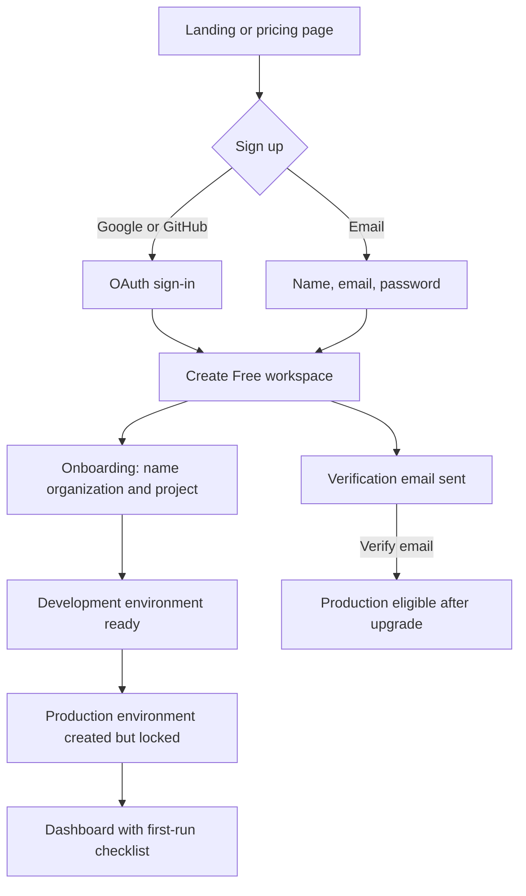
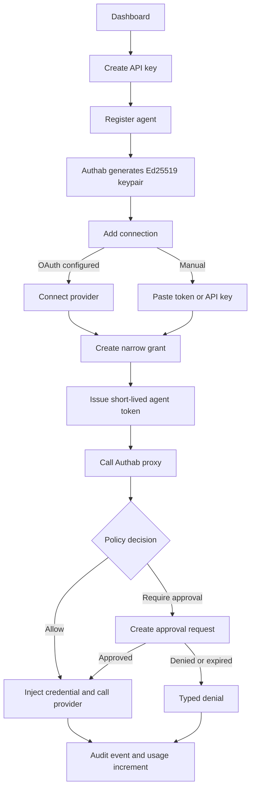
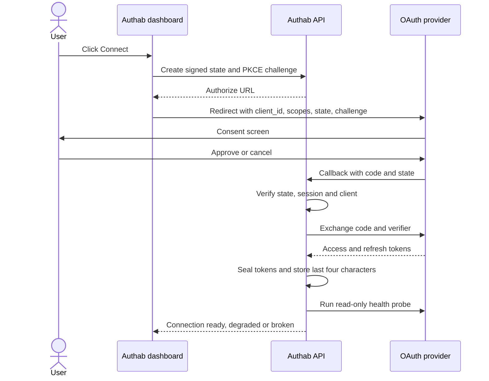
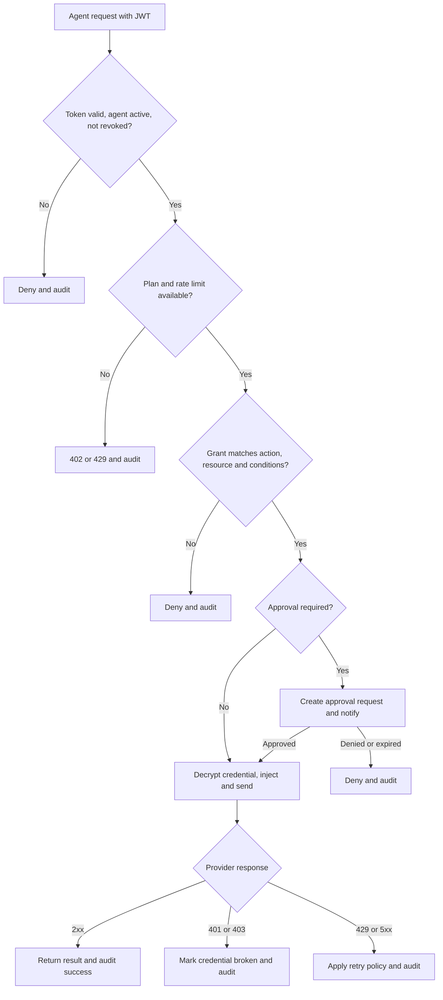
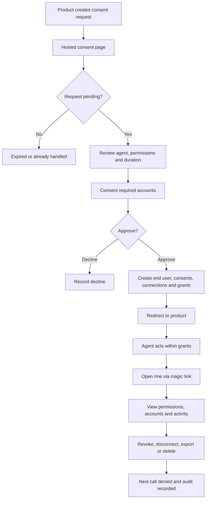
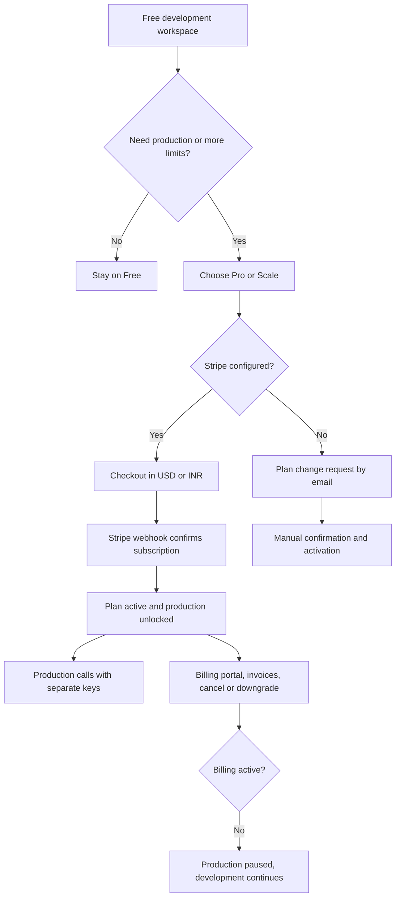
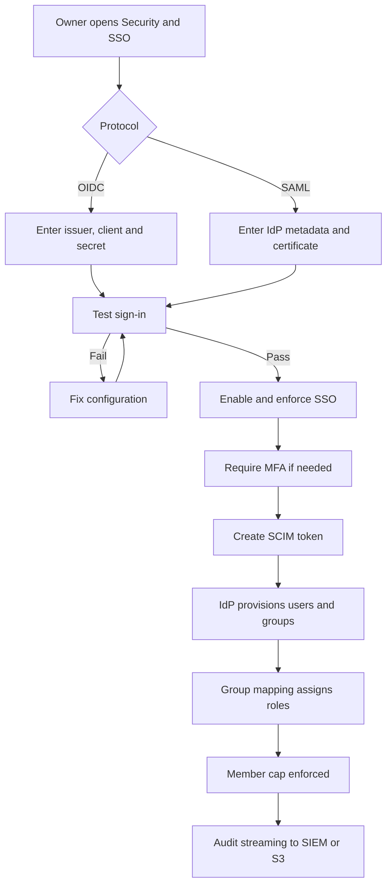
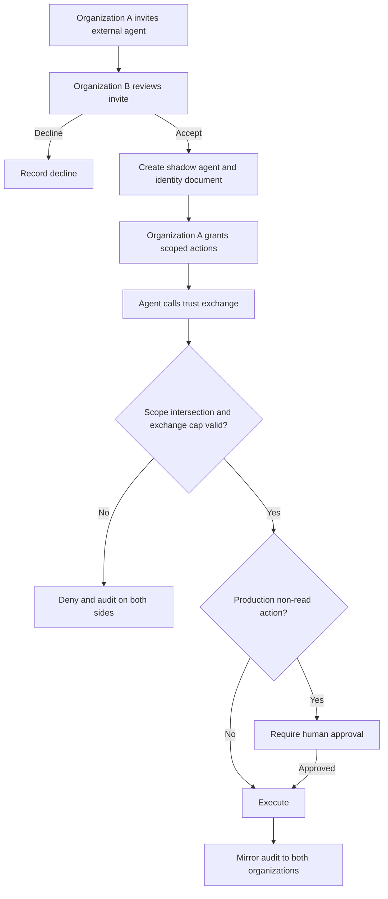

# Authab user journeys and user flows

Status: **Draft for review** · 17 November 2026
Related: [Launch requirement sheet](requirements.md)

## 1. How to read this

- A **journey** is the human experience: what someone is trying to do, what they see, what can go wrong, and what success feels like.
- A **flow** is the deterministic path through screens and services.
- The journeys below are written from the shipped product surfaces, not an aspirational future state. Where a step is assisted or not yet live-verified, it is marked.

## 2. Actors and surfaces

| Actor | Job to be done | Main surfaces |
| --- | --- | --- |
| **Ravi**, indie agent developer | Ship an agent that acts on real tools this afternoon without hard-coding secrets | Landing, sign-up, onboarding, quickstart, Developers, Agents, Vault, Permissions, Playground, docs |
| **Meera**, product and engineering lead | Put an agent in front of customers without losing control of permissions or spend | Dashboard, Permissions, Approvals, Billing, Production upgrade, Audit |
| **Daniel**, security engineer or approver | Prove what an agent can do, approve the risky calls and keep evidence | Security, SSO and identity, Approvals, Activity, audit streaming, Trust center |
| **Priya**, end user of a product built on Authab | Understand what an agent may do for her and revoke it | Hosted consent page, `/me` control center |
| **Fatima**, enterprise platform admin | Standardize agent access across teams, vendors and identity providers | SSO/SCIM, Trust, custom connectors, config-as-code, audit sinks, DPA |

Operator journeys for support and on-call are included because they affect the customer experience during incidents.

## 3. North-star journey

The launch is working when this path is boring:

> Ravi signs up, registers an agent, connects one real tool, grants one narrow action, issues a short-lived token, makes one governed call, and sees the audit entry — in under 15 minutes, without pasting a secret into his agent code.

Every product change should be judged against whether it shortens or lengthens this path.

## 4. Persona journeys

### 4.1 Ravi — first governed call

**Goal:** make one real provider call through Authab with a scoped, revocable permission.

**Entry:** landing page, docs quickstart, or a colleague's invite.

**Preconditions:** a Free workspace; a provider credential or an OAuth app configured by the workspace; a connector in the launch set.

**Steps**

1. Ravi reads the landing process and pricing. Free is development-only; production requires Pro.
2. He signs up with Google/GitHub or email and password. Email sign-up creates a session immediately and sends a verification link; verification is required to unlock production, not to build in development.
3. He names the organization and project. Authab creates a development environment and a production environment that is locked until Pro.
4. The dashboard shows an empty fleet, zero connections and a first-run checklist.
5. He opens **Developers** and creates an API key. The secret is shown once; only a prefix remains.
6. He opens **Agents** and registers an agent. Authab generates an Ed25519 keypair; the private key is shown once. The agent is active in development.
7. He opens **Vault** and adds a connection. If OAuth is configured for the provider, he clicks Connect. Otherwise he pastes an API token into the connector's fields.
8. He opens **Permissions** and grants that agent one specific action on one resource pattern. He avoids a wildcard grant and may add an expiry.
9. He issues a short-lived agent token with the SDK or CLI, then calls the proxy for the granted action.
10. Authab evaluates token, agent status, environment, connector, action, credential, grant, resource and conditions. If everything matches, it injects the credential and calls the provider.
11. The provider responds; Authab records the decision, latency and outcome in the append-only audit chain and increments the usage meter.
12. Ravi opens **Activity** and sees the call. He can invite a teammate or upgrade when he is ready for production.

**Success:** first call succeeds, the credential never appears in agent code, the audit entry is visible, and the grant can be revoked.

**Failure branches**

| Failure | What Ravi sees | Recovery |
| --- | --- | --- |
| Verification email missing | Development still works; production remains locked | Resend from the account page; check spam; support route |
| OAuth not configured | "OAuth connect is not configured" with a link to OAuth apps and a manual-token path | Admin configures the app or Ravi pastes a token |
| Provider rejects the credential | Connection health turns broken with an actionable message | Replace the token or reconnect OAuth |
| No matching grant | Typed denial names the missing grant | Create or widen a grant; no silent retry |
| Plan cap reached | 402 with the current usage and upgrade path | Upgrade or wait for the period reset |
| Approval required | Request is pending with a link to the inbox | Approver decides, or the request expires |

**Surfaces:** `/`, `/sign-up`, `/onboarding`, `/app`, `/app/developers`, `/app/agents/new`, `/app/vault/new`, `/app/permissions`, `/app/activity`.

**Metric:** sign-up to first successful proxy call; target under 15 minutes on the quickstart path.

### 4.2 Ravi — OAuth connection lifecycle

**Goal:** connect a provider without copying a long-lived secret.

**Preconditions:** an owner or admin configured an OAuth app in **OAuth apps**, or the deployment has `CONNECT_<PROVIDER>_CLIENT_ID` and `_CLIENT_SECRET`.

**Steps**

1. In **Vault → New connection**, Ravi chooses the provider. The card says **Connect ready** only when a client is resolved.
2. He clicks Connect. Authab creates a signed state and an S256 PKCE challenge, then redirects to the provider.
3. The provider shows its consent screen. Ravi approves the requested scopes or cancels.
4. The callback verifies the signed state, the signed-in user and the client ID before exchanging the code.
5. Authab seals the access and refresh tokens with the connection's data key. Only the last four characters of the access token remain in clear text.
6. Authab runs a read-only health probe and shows the connection as healthy, degraded or broken.
7. Ravi grants a specific action and makes a call.
8. Before expiry, the proxy refreshes the token with a five-minute margin and rotates the refresh token. A permanent refresh failure marks the connection broken and notifies owners.
9. Ravi can disconnect at any time; the credentials are destroyed and every grant for that connection expires.

**Success:** no secret copy/paste; refresh works; disconnect and revoke take effect on the next call.

**Failure branches:** redirect URI mismatch; user cancels; scope denied; provider rejects the exchange; provider rate limit; refresh token already rotated or revoked.

**Surfaces:** `/app/connect`, `/app/vault/new`, `/app/vault`, consent callback, health timeline.

### 4.3 Meera and Daniel — human approval

**Goal:** let a risky action proceed only with an accountable human decision.

**Trigger:** a write, destructive, financial or admin action in production; a policy or safe-launch rule; a production non-read action from a cross-org shadow agent.

**Steps**

1. The agent calls the proxy. The policy engine decides that a human is required.
2. Authab creates an approval request with the agent, connection, action, risk, expiry and a **redacted** payload. It returns a pending result to the agent.
3. Approvers receive an in-app notification, email, Slack message or webhook, depending on workspace settings.
4. Daniel opens the signed approval link. If he is not signed in, he signs in first.
5. Authab checks that he is a member of the organization and has the approve capability. A viewer or developer without the capability sees a permission message.
6. Daniel reviews the redacted payload, the grant scope and the risk. He can add a note, approve once, deny, or approve this action automatically for the grant from now on.
7. On approval, the proxy executes the call once, returns the result to the waiting agent and records both the approval and the execution.
8. On denial or expiry, the agent receives a typed denial; nothing is sent to the provider.
9. Every decision is in the audit chain. The approvals inbox keeps pending, approved, denied, expired and failed states.

**Success:** the approver sees enough context to decide, no secret or sensitive content leaks into the approval payload, and the decision is auditable.

**Failure branches**

| Failure | Behaviour |
| --- | --- |
| Approver lacks the capability | Permission message names the roles that can decide |
| Link expired or already decided | Final state is shown; the inbox remains the source of truth |
| Approval expires | Agent receives an expiry error; audit records it |
| Provider fails after approval | Approval remains approved; execution is marked failed with a retry path |
| Approver wants a standing rule | "Approve always" applies only to that grant, not the whole workspace |

**Surfaces:** `/approve/[token]`, `/app/approvals`, notification email/Slack/webhook, audit.

**Metric:** approval latency p50 and p95; expired-request rate.

### 4.4 Priya — consent and control center

**Goal:** understand what an agent may do, grant only what she chooses, and revoke it later.

**Preconditions:** a product using Authab creates a consent request for an agent, connectors, scopes, duration and redirect URI, with its branding.

**Steps**

1. Priya opens the hosted consent link at `/consent/<token>`.
2. She sees the product name, the agent name, the requested permission groups, the offered durations and where the result will return. A verified-domain badge appears when the product has proved domain ownership.
3. She connects each required account through the provider's OAuth screen. If a connector is not connected, the page will not let her approve.
4. She selects the permission groups and duration she is willing to grant, or declines.
5. On approval, Authab creates the end-user record, consents, connections and grants scoped to her. It redirects to the product's allowed URI.
6. The product's agent acts within those grants. Priya can open `/me` from the product or from an Authab email.
7. `/me` asks for her email and sends a single-use magic link. The link expires in 15 minutes and is rate-limited.
8. She sees every product, agent, permission, connected account and recent activity. Activity shows what happened, never the content sent or returned.
9. She revokes a permission; the next agent call is denied. She disconnects an account; the credentials are destroyed and every grant for it expires.
10. She downloads her data immediately. A deletion request is recorded, the product's owners are notified, and every permission is revoked; the request status stays visible.

**Success:** Priya can explain what she approved, revoke it without contacting support, and see that the product must complete a deletion request.

**Failure branches**

| Failure | What Priya sees | Recovery |
| --- | --- | --- |
| Link expired or already used | "This request has expired" or "already handled" | Ask the product for a new request |
| Connector not connected | Inline error; approval blocked | Connect the account |
| No permission groups selected | "Keep at least one permission group" | Select one or decline |
| Redirect URI not allowed | Request is not created | Product fixes its allowed redirect URIs |
| Magic link not delivered | Generic "if that email is on file" message | Check spam, wait, request again |
| Deletion still pending | Request status shows pending | Product owner completes it; support route |

**Surfaces:** `/consent/[token]`, `/me`, `/me/export`, provider OAuth screens, consent email.

**Metric:** consent approval completion; revoke success; deletion request completion time.

### 4.5 Meera — upgrade to Pro and unlock production

**Goal:** move a working development setup into production and pay for it.

**Preconditions:** a Free workspace with a working development call; a verified email; Stripe configured for card checkout, or the email fallback for plan changes.

**Steps**

1. Meera opens the production environment or a usage meter and hits the plan gate.
2. The upgrade page explains what production adds: a separate identity, production-only connections, approvals and safe launch, and longer audit retention.
3. She compares Pro and Scale. The page shows USD or INR based on the workspace billing currency.
4. She starts checkout. Stripe collects payment; Authab does not charge a card in its own UI.
5. Stripe sends the subscription webhook. Authab activates the plan, updates limits and unlocks production automatically.
6. If Stripe is not configured, the button becomes a plan-change request by email; an operator confirms payment before activation.
7. Meera promotes the agent and connection to production. Production has its own keys and vault entries; development credentials do not cross over.
8. She configures approvals and safe launch for the first production days.
9. She makes a production call and sees a 90-day audit trail on Pro or one year on Scale.
10. She opens **Billing** for invoices, payment-method updates, cancellation or a plan change. If billing becomes inactive, production calls pause while development keeps working.

**Success:** production unlocks only after a confirmed subscription; the invoice is available; cancellation and downgrade semantics are clear.

**Failure branches:** payment fails (past due, limits paused, retries, suspension after seven days); checkout canceled; currency not configured; member or connection cap reached; workspace not eligible for a trial.

**Surfaces:** `/app/upgrade/production`, `/app/billing`, `/pricing`, Stripe checkout and portal, webhook.

**Metric:** trial start to paid conversion; checkout completion; involuntary churn.

### 4.6 Fatima — SSO, SCIM and audit evidence

**Goal:** make Authab fit an enterprise identity and evidence model.

**Preconditions:** an owner account; an IdP administrator; a plan that includes the required features.

**Steps**

1. Fatima opens **Security → SSO and identity**.
2. She creates an OIDC or SAML connection, enters the issuer or IdP metadata, allowed email domains, default role and optional group-to-role mapping.
3. She copies the callback URL, ACS URL or SP metadata to the IdP.
4. She tests a sign-in before enforcing anything. A misconfigured issuer or certificate returns a clear error.
5. She enables the connection, then enforces SSO for the organization and can require MFA.
6. She creates a SCIM bearer token and gives the IdP `${APP_URL}/api/scim/v2`. The token is shown once and stored hashed.
7. The IdP provisions users and groups. Group mapping assigns roles other than owner. The plan's member cap is enforced during provisioning and sign-in.
8. Deprovisioning removes access; existing sessions and tokens follow the suspension rules.
9. She configures audit streaming to the company SIEM or S3 bucket, sends a test delivery and verifies the HMAC and chain columns.
10. She reviews the trust center for subprocessors, DPA status and the current list of uncompleted certifications.

**Success:** an employee can sign in through the IdP, get the right role, and lose access when deprovisioned; audit events arrive in the SIEM with verifiable ordering.

**Failure branches:** issuer/certificate invalid; email domain not allowed; member cap reached; SCIM token revoked; IdP deprovision delay; SIEM delivery failure.

**Surfaces:** `/app/security/sso`, IdP admin console, `/api/scim/v2`, `/app/security/streaming`, `/trust`.

**Metric:** SSO sign-in success; SCIM provisioning success; audit delivery lag.

### 4.7 Meera and Fatima — cross-org trust

**Goal:** let a partner's agent act inside another organization without sharing long-lived credentials.

**Steps**

1. Organization A invites an external agent from Organization B, with scopes, environment type, expiry and purpose.
2. Organization B accepts or declines. On accept, Authab creates a shadow agent and an identity document; the external agent cannot bootstrap its own credentials.
3. Organization A grants the shadow agent a narrow set of actions. The environment type must match.
4. Calls go through the trust exchange. Authab takes the intersection of grants, the trust cap and the request, and applies a short exchange lifetime.
5. In production, a non-read action always needs a human, even if the grant would otherwise allow it.
6. Audit events are mirrored to both organizations. Either side can revoke; access stops on the next call.

**Success:** a partner agent can do a narrow job without receiving the host's keys; both security teams can see and revoke the relationship.

**Failure branches:** environment mismatch; expired invite; scope escalation attempt; shadow agent tries to create its own credentials; one side revokes.

**Surfaces:** `/app/trust`, trust invite link, audit in both organizations.

**Metric:** trust relationship time-to-first-call; revoke effectiveness.

### 4.8 On-call — incident and status

**Goal:** detect, communicate and mitigate a production problem without improvising.

**Steps**

1. Detection fires from uptime checks, error-rate alerts, audit-chain verification, connector health or a customer report.
2. The on-call assigns a severity using the incident matrix.
3. If customers are affected, publish an incident on `/status` and notify affected workspaces.
4. Mitigate: roll back the deployment, disable the affected connector or feature flag, rotate a key, or restore from a branch/backup.
5. Verify recovery with the same checks that fired.
6. Publish a postmortem with timeline, impact, root cause and action items.
7. If credentials or data may be exposed, follow the breach-notification runbook and legal timeline.

**Success:** customers learn about incidents from Authab before they learn from their own monitoring; the fix is verified; the postmortem has owners and dates.

## 5. End-to-end flow diagrams

| Journey | Diagrams |
| --- | --- |
| 4.1 First governed call | 5.1, 5.2, 5.4 |
| 4.2 OAuth connection | 5.3 |
| 4.3 Human approval | 5.4 |
| 4.4 Consent and control center | 5.5 |
| 4.5 Upgrade to production | 5.6 |
| 4.6 SSO and SCIM | 5.7 |
| 4.7 Cross-org trust | 5.8 |
| 4.8 Incident and status | Runbook, not a user flow |

### 5.1 Sign-up and onboarding

### 5.2 First governed call

### 5.3 OAuth connect

### 5.4 Proxy decision

### 5.5 Consent and control center

### 5.6 Billing and production unlock

### 5.7 SSO and SCIM

### 5.8 Cross-org trust

## 6. Edge cases and recovery

| Situation | User-visible behaviour | Required recovery |
| --- | --- | --- |
| Email verification not delivered | Development works; production stays locked | Resend, check spam, support route |
| OAuth app missing or misconfigured | Manual token path remains; OAuth card says not configured | Admin configures app; redirect URI shown |
| OAuth token expires or is revoked | Connection marked broken; calls fail with an actionable error | Reconnect or replace credential |
| Grant missing or too narrow | Typed denial names the missing permission | Create a narrow grant; no wildcard shortcut |
| Approval request expires | Agent receives an expiry error | Re-request; approver uses the inbox |
| Plan limit reached | 402 with usage and upgrade path | Upgrade or wait for reset |
| Payment fails | Past due; paid limits paused; development continues | Update card; recovery window |
| SSO misconfigured | Sign-in fails with a config message | Fix issuer/certificate; test before enforcing |
| Consent link expired | Request cannot be approved | Product sends a new request |
| Deletion request pending | Status remains visible in `/me` | Product owner completes; support escalation |
| Audit verification fails | Security alert; verify endpoint reports the break | Treat as incident; do not repair rows in place |
| Provider outage | Connector health degrades; calls fail closed | Retry/backoff; status update if widespread |

## 7. UX and copy guardrails

- **Separate landing and product.** Marketing pages explain the category; the dashboard is for operating it. Do not reuse landing-page hero layouts inside the app.
- **Say what is true.** A connector is Stable only with dated live proof. Otherwise it is Beta or "add your credentials."
- **One next action per empty state.** Empty fleet, empty vault, empty permissions and empty audit each link to the exact next step.
- **Explain denials.** Every policy denial names the missing grant, the environment mismatch or the plan limit. Never show a raw provider error.
- **Secrets are shown once.** API keys, agent private keys, connection secrets and SCIM tokens are never retrievable after creation.
- **Paid CTAs say "Upgrade to Pro" or "Upgrade to Scale."** Never "Request Pro" or "Request Scale."
- **Production is a gate, not a surprise.** Explain why production is locked, what it unlocks and how to return to development.
- **End-user language is plain.** No internal terms such as grant, token or connector on the consent page unless they are explained.
- **Light and dark both count.** Every new surface is checked in both themes before it is called done.
- **Accessibility is part of the flow.** Keyboard order, focus states, contrast and screen-reader labels are tested on the core paths.

## 8. Instrumentation

Instrument the journey, not just page views. No secrets, emails or payload content.

| Event | When | Useful properties |
| --- | --- | --- |
| `signup_started` | Sign-up form opened | Auth method |
| `signup_completed` | Account created | Auth method, invite or self-serve |
| `onboarding_completed` | Organization and project named | Time since signup |
| `api_key_created` | First API key | Environment type |
| `agent_created` | Agent registered | Framework, key mode |
| `connection_started` | Vault new connection | Connector, auth method |
| `connection_ready` | Credential or OAuth saved | Connector, auth method, health |
| `grant_created` | Grant saved | Connector, action count, wildcard flag |
| `token_issued` | Agent token issued | TTL bucket |
| `proxy_call` | Proxy completes | Connector, action risk, decision, status class, latency |
| `approval_requested` | Approval created | Risk, channel |
| `approval_decided` | Approval decided | Decision, latency, approve-always |
| `consent_approved` | End user approves | Permission count, duration |
| `consent_revoked` | End user revokes | Source |
| `checkout_started` | Stripe checkout opened | Plan, currency |
| `subscription_activated` | Webhook activates plan | Plan, currency |
| `production_unlocked` | Plan gate passes | Plan |
| `sso_login` | SSO sign-in completes | Protocol, IdP |
| `audit_verify_failed` | Verification reports a break | Environment, chain head |

## 9. Assumptions and open questions

- **Launch connector set:** assumed 8–12 Stable connectors, with the rest visible as Beta. Confirm before the OAuth review work starts.
- **Google scopes:** assumed no restricted Gmail scopes at launch. Confirm whether Gmail is required for the first customers.
- **Enterprise:** assumed assisted SSO/SCIM at launch. Confirm whether any design partner requires self-serve SCIM on day one.
- **Support:** assumed one business day for email. Confirm staffing.
- **Refunds:** assumed 14-day money-back on the first purchase, manual. Confirm policy and tax treatment.
- **Region:** assumed one region at launch. Confirm whether any customer requires data residency before signing.
- **Email verification:** email/password sign-up creates a session immediately; verification unlocks production. Confirm this remains the intended onboarding rule.
- **Demo:** assumed demo login and seed are off in production. Confirm the demo workspace is not linked from public pages.
